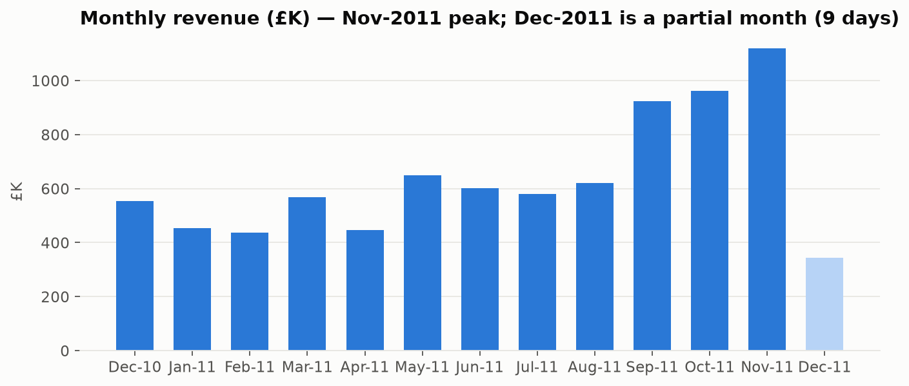
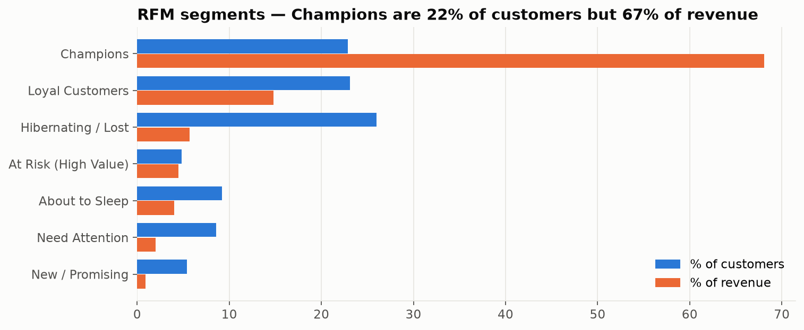
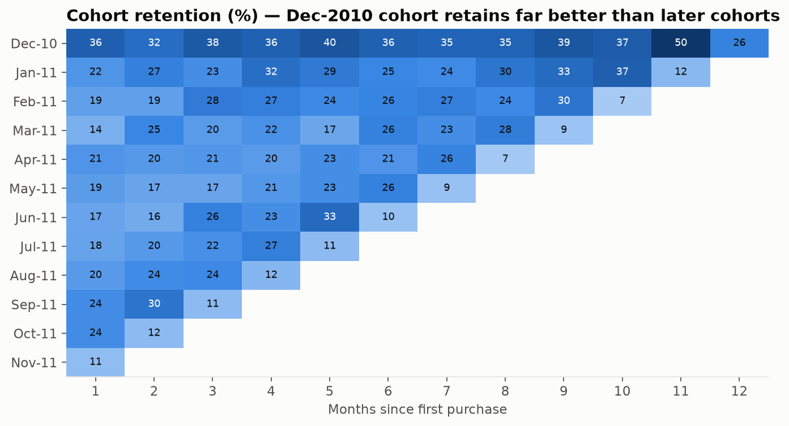
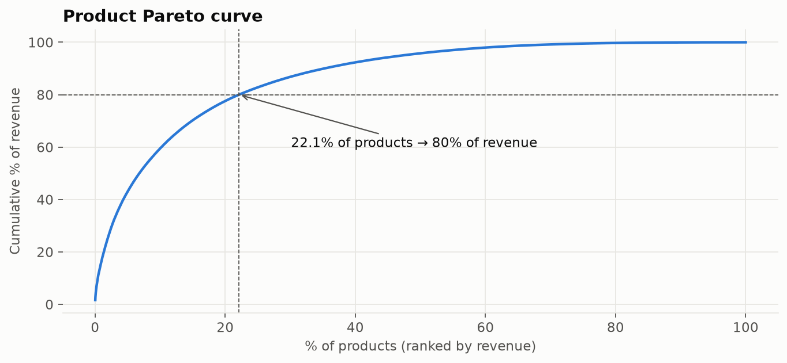
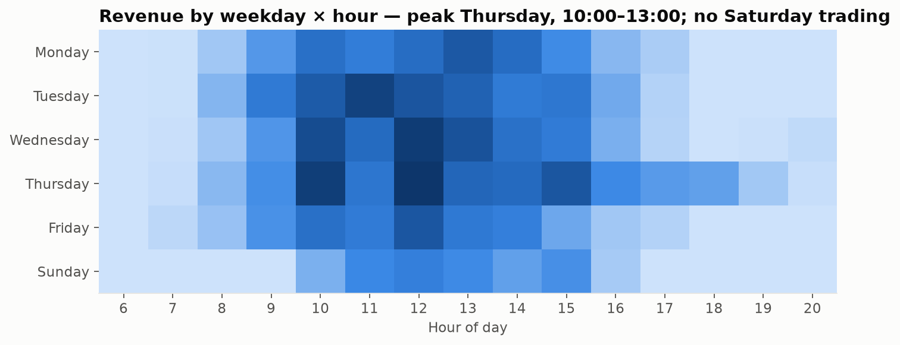

# 🛒 E-commerce Customer Analytics — RFM, Cohort Retention & Market Basket (SQL + Python)

**▶ Live interactive dashboard:** https://pragati-gautam14.github.io/ecommerce-customer-analytics/

End-to-end analysis of **541,909 transactions** from a UK online gift retailer (Dec 2010 – Dec 2011) to answer three business questions:

1. **Who are our most valuable customers?** → RFM segmentation
2. **How well do we keep them?** → monthly cohort retention & repeat-purchase rate
3. **What should we sell together, when and where?** → market-basket analysis, Pareto, seasonality, country mix

All data modelling is done in **SQL** (DuckDB, window functions, CTEs, self-joins); Python handles orchestration and visualisation; a **Power BI** star schema + DAX measures are included.

---

## 📌 Key findings

| # | Insight | Recommended action |
|---|---------|-------------------|
| 1 | **Champions = 22% of customers but 67% of revenue** (avg spend £5.8K) | Loyalty tier / early access to protect this group |
| 2 | **292 high-value customers are "At Risk"** — avg 131 days since last order, £459K historic revenue | Targeted win-back campaign (list exported from SQL) |
| 3 | Only **~20% of new customers return in month 1**, yet repeat buyers (65% of customers) drive **93% of revenue** | Welcome journey + second-order incentive |
| 4 | **Sep–Nov delivered 38% of annual revenue**; peak trading Thursday 10:00–13:00, no Saturday trading | Ramp inventory & staffing from August; time campaigns mid-week |
| 5 | **22% of products (806 SKUs) generate 80% of revenue**; cancellations cost **5.4% of gross sales** (£474K) | Prioritise top SKUs in stock planning; investigate high-cancel items |
| 6 | Product pairs (teacup sets, lunch bags, alarm clocks) are bought together **7–18× more than chance** (lift) | "Frequently bought together" bundles |
| 7 | UK = 82% of revenue; Netherlands, EIRE, Germany, France have high revenue per customer | Test targeted expansion in these markets |





<details><summary>More charts</summary>



</details>

---

## 🧹 Data cleaning (logged in `data_quality_log`)

| Check | Rows |
|---|---|
| Raw rows | 541,909 |
| Missing CustomerID | 135,080 |
| Cancellation lines (C-invoices) | 9,288 |
| Non-product codes (postage, fees, adjustments) | 2,950 |
| Zero / negative price | 2,517 |
| Exact duplicate lines | 5,270 |
| Purchases later reversed by a matching cancellation | 4,032 |
| **Clean rows kept** | **387,230** |

The reversal rule matters: without it a single cancelled 80,995-unit order would appear as the #1 product.

## 🛠️ SQL techniques used

| File | What it does | Techniques |
|---|---|---|
| `sql/01_data_cleaning.sql` | Typing, cleaning, quality log, reversed-order detection | `strptime`, CTAS, `ANTI JOIN`, self-join |
| `sql/02_kpi_trends.sql` | Monthly KPIs, MoM growth, cumulative revenue, weekday×hour | `LAG`, running `SUM() OVER`, named `WINDOW` |
| `sql/03_rfm_segmentation.sql` | RFM scores & segments | `NTILE`, `CASE`, share-of-total windows |
| `sql/04_cohort_retention.sql` | Acquisition cohorts & retention matrix | CTEs, `date_diff`, `FIRST_VALUE` |
| `sql/05_product_country.sql` | Pareto, country mix, cancellations | cumulative windows, `FILTER` aggregates |
| `sql/06_market_basket.sql` | Support / confidence / lift for product pairs | self-join on basket, `HAVING` thresholds |

## 📂 Project structure

```
├── sql/                 # all business logic (6 SQL models)
├── src/
│   ├── download_data.py # fetches the public dataset
│   ├── run_pipeline.py  # runs SQL on DuckDB, exports tables + Power BI files
│   ├── build_report.py  # charts + interactive dashboard
│   └── viz.py
├── notebooks/analysis.ipynb   # narrated walkthrough with outputs
├── outputs/tables/      # result tables (CSV)
├── outputs/charts/      # PNG charts
├── powerbi/             # star-schema CSVs + DAX measures
└── docs/index.html      # interactive dashboard (GitHub Pages)
```

## ▶️ How to run

> ⚙️ **Automated:** the full pipeline (SQL models → analysis → charts → notebook → dashboard) re-runs on **GitHub Actions** (`.github/workflows/build.yml`) whenever `sql/` or `src/` changes.

```bash
pip install -r requirements.txt
python src/download_data.py      # ~45 MB public dataset
python src/run_pipeline.py       # SQL models -> outputs/tables, powerbi/
python src/build_report.py       # charts + docs/index.html
```

## 📚 Dataset
[UCI Online Retail](https://archive.ics.uci.edu/dataset/352/online+retail) — Daqing Chen, Sai Liang Sain & Kun Guo (2012). Public mirror used for download: Databricks *Spark: The Definitive Guide* repository.

**Tools:** SQL (DuckDB) · Python (pandas, NumPy, Matplotlib, Plotly) · Jupyter · Power BI (DAX) · Git
